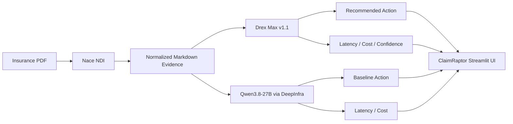
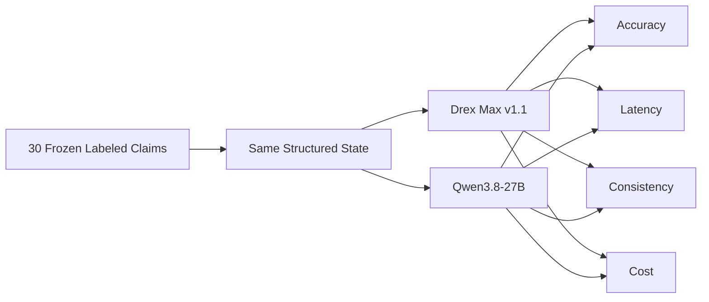

# 🦖 ClaimRaptor

**Evidence-grounded insurance decision support powered by NDI + Drex.**

ClaimRaptor turns messy insurance documents into structured evidence and compares a specialized decision model, **Drex**, against a general-purpose LLM baseline, **Qwen3.8-27B via DeepInfra**.

The project was built for the **Nace AI Drexathon – Apex Predator track**.

---

## The Problem

Insurance claim review often begins with messy, inconsistent documents:

- policy declarations
- repair estimates
- loss notices
- adjuster reports
- subrogation letters
- supporting evidence

A general-purpose LLM can read these documents, but insurance decisions require something more specific:

- consistent policy reasoning
- explicit handling of missing evidence
- low latency
- predictable behavior
- low cost
- defensible human review paths

ClaimRaptor asks:

> Can a specialized decision model outperform a general-purpose reasoning model on insurance claim decisions?

---

## What ClaimRaptor Does

ClaimRaptor has two complementary evaluation modes.

### 1. Real-World Claim Analyzer

Users upload real insurance PDFs.

ClaimRaptor performs:

```text
Insurance PDF
      ↓
     NDI
      ↓
Normalized Markdown Evidence
      ↓
 ┌───────────┬───────────────┐
 │   Drex    │ Qwen3.8-27B   │
 │ System 1  │ via DeepInfra │
 └───────────┴───────────────┘
      ↓               ↓
 Decision          Decision
 Latency           Latency
 Cost              Cost
      └──────┬────────┘
             ↓
      Live Comparison
```

NDI parses each document **once**.

Both Drex and Qwen then receive the same normalized evidence and follow the same decision policy.

The real-world mode compares:

- recommendation
- decision agreement
- model latency
- inference cost
- Drex confidence
- Drex probability distribution
- NDI parsing output

Because the public real-world documents do not contain verified adjudication labels, ClaimRaptor **does not claim accuracy on these documents**.

---

### 2. Apex Predator Benchmark

The second mode is a controlled benchmark with known labels.

It contains:

- 30 unique synthetic insurance claim states
- 10 `APPROVE`
- 10 `DENY`
- 10 `MANUAL REVIEW`
- explicit policy rules
- fixed ground-truth labels
- identical structured input for both models

Each claim is evaluated three times.

The first measured trial is used for primary accuracy.

Repeated trials are used for latency and consistency measurements.

---

# Apex Predator Results

## Controlled 30-Claim Benchmark

| Metric | Drex Max v1.1 | Qwen3.8-27B |
|---|---:|---:|
| Accuracy | **100.00%** | 96.67% |
| Median latency | **225 ms** | 283 ms |
| P95 latency | **324 ms** | 1239 ms |
| Consistency | **100.00%** | 96.67% |
| Cost / 1K decisions | **~$0.0105** | ~$0.0547 |

### Headline

On a 30-claim synthetic benchmark with explicit policy rules:

- Drex achieved **100% accuracy**
- Qwen achieved **96.7% accuracy**
- Drex had approximately **1.25× lower median latency**
- Drex had approximately **3.82× lower p95 latency**
- Qwen cost approximately **5.19× more per decision**
- Drex produced identical decisions across all repeated trials

Qwen's primary benchmark error occurred on a boundary case where an incident occurred on the final active day of the policy.

---

# Real-World Evaluation

ClaimRaptor was also tested on three cleaned public insurance-document packets.

These documents include real insurance notices, subrogation correspondence, estimates, and vehicle-loss information.

## Latest Live Session

| Metric | Result |
|---|---:|
| Documents | 3 |
| Drex / Qwen agreement | **3 / 3** |
| Drex median latency | 770 ms |
| Qwen median latency | **483 ms** |
| Qwen / Drex inference-cost ratio | **~4.80×** |

All three documents resulted in:

```text
MANUAL REVIEW
```

for both models.

This is desirable behavior because the supplied records contain evidence of claims and losses but do not provide enough complete policy coverage information to safely establish approval or denial.

### Important Interpretation

The real-world test is **not an accuracy benchmark**.

It demonstrates behavior on messy public documents.

In this particular three-document session, Qwen was faster than Drex.

The controlled 30-case benchmark is where ClaimRaptor measures accuracy, repeatability, and comparative benchmark latency.

This distinction is intentional.

---

# Decision Policy

Both live models follow the same core rules:

1. Use only evidence contained in the supplied documents.
2. Never invent missing policy terms.
3. A repair estimate, payment record, claim notice, or subrogation demand does not by itself prove policy coverage.
4. Missing or ambiguous coverage information results in `MANUAL REVIEW`.
5. `APPROVE` requires sufficient evidence that the loss is covered.
6. `DENY` requires sufficient evidence that the claim is clearly ineligible or excluded.

This helps prevent the system from confidently inventing insurance coverage that is not present in the evidence.

---

# Why Drex?

General-purpose LLMs are designed to produce language.

Insurance claim triage is fundamentally a **decision problem**.

ClaimRaptor uses Drex as the specialized decision layer and demonstrates that, on the controlled benchmark, it can offer:

- stronger decision accuracy
- better repeatability
- lower inference cost
- better tail latency
- explicit probability distributions
- decision-specific behavior

---

# Nace AI Stack

## NDI

Nace Document Intelligence converts real insurance PDFs into normalized Markdown evidence.

NDI handles documents containing:

- tables
- scanned layouts
- claim correspondence
- estimates
- insurer forms
- multi-page packets

The resulting evidence becomes the common input for both competing models.

---

## Drex

Drex performs the primary insurance decision.

The live application currently evaluates:

```text
approve
manual_review
deny
```

Drex also exposes:

- decision confidence
- probability distributions
- token usage
- latency

---

## Intern

Nace Intern was used as an engineering agent during development and final repository review.

Intern uses:

- Drex as System 1
- Qwen3.8-27B via DeepInfra as System 2

During development, Intern identified a real demo-reliability issue: one failing document could terminate an entire multi-document Streamlit run.

The application was updated so that:

- each document is isolated with per-document error handling
- already-completed results survive a later failure
- all-failure batches are handled safely

Intern was also used for the final pre-submission repository audit.

---

# Architecture



### Controlled Benchmark



---

# Fairness of the Comparison

The benchmark was designed to avoid giving Drex an artificial advantage.

Both models receive:

- the same claim state
- the same policy information
- the same expected decision classes

Other controls include:

- API warmup before measurements
- randomized request ordering
- multiple trials
- wall-clock measurement using `time.perf_counter()`
- fixed ground-truth labels before evaluation

The synthetic benchmark dataset and recorded benchmark results were frozen after evaluation.

---

# Repository Structure

```text
ClaimRaptor/
│
├── app.py
│
├── requirements.txt
├── README.md
│
├── data/
│   ├── test_claim.pdf
│   ├── denied_claim.pdf
│   ├── review_claim.pdf
│   └── real_world_clean/
│       ├── nationwide_chrysler_fire_notice.pdf
│       ├── nationwide_kia_fire_notice.pdf
│       └── progressive_fire_claim_packet.pdf
│
├── results/
│   ├── benchmark_summary.json
│   ├── full_benchmark_raw.csv
│   ├── accuracy.csv
│   ├── class_accuracy.csv
│   ├── latency.csv
│   ├── cost.csv
│   ├── consistency.csv
│   └── errors.csv
│
└── src/
    ├── benchmark_full.py
    ├── generate_benchmark_cases.py
    ├── prepare_real_world_packets.py
    └── ...
```

---

# Running ClaimRaptor

## 1. Clone

```bash
git clone https://github.com/Soham-Raj-Jain/ClaimRaptor.git
cd ClaimRaptor
```

## 2. Create a virtual environment

### Windows

```powershell
python -m venv .venv
.\.venv\Scripts\Activate.ps1
```

### macOS / Linux

```bash
python3 -m venv .venv
source .venv/bin/activate
```

## 3. Install dependencies

```bash
pip install -r requirements.txt
```

## 4. Configure API keys

Create:

```text
.env
```

with:

```text
NACE_API_KEY=your_nace_key
DEEPINFRA_API_KEY=your_deepinfra_key
```

`.env` is excluded from Git.

Never commit API keys.

## 5. Start the app

```bash
streamlit run app.py
```

---

# Reproducing the Benchmark

The repository contains the benchmark source and recorded results.

To run the benchmark:

```bash
python src/benchmark_full.py
```

The benchmark makes paid API calls.

The included results are retained so judges can inspect the exact outputs used in the submission.

---

# Preparing the Public Real-World Packets

The original large public source packets are intentionally not committed.

The repository contains the cleaned excerpts used by the live demo.

The preparation utility is:

```bash
python src/prepare_real_world_packets.py
```

The cleaned outputs are stored under:

```text
data/real_world_clean/
```

---

# Responsible Use

ClaimRaptor is a **decision-support prototype**, not an autonomous insurance adjudication system.

It should not make legally binding claim decisions without human oversight.

Real-world deployment would require:

- complete policy documents
- verified claim evidence
- insurer-specific rules
- audit logging
- regulatory review
- human adjuster oversight
- privacy and security controls
- broader real-world validation

The application intentionally routes incomplete or ambiguous evidence to:

```text
MANUAL REVIEW
```

rather than fabricating missing coverage.

---

# Limitations

The controlled benchmark is synthetic and contains only 30 unique claims.

It demonstrates comparative behavior under known rules but does not establish production insurance accuracy.

The public real-world evaluation contains only three cleaned document packets and has no independently verified adjudication ground truth.

Latency can vary across API providers, network conditions, prompt size, and service load.

Inference-cost comparisons are estimates based on the configured model pricing used by the project.

---

# Built With

- **Nace Drex**
- **Nace Document Intelligence (NDI)**
- **Nace Intern**
- **DeepInfra**
- **Qwen3.8-27B**
- **Streamlit**
- **Python**
- **Pandas**

---

# Hackathon Track

## Apex Predator

ClaimRaptor directly evaluates Drex against a general-purpose LLM on the same decision task.

The controlled benchmark shows that Drex produced:

- higher accuracy
- stronger consistency
- lower median latency
- dramatically lower p95 latency
- substantially lower inference cost

The real-world document mode complements the benchmark by demonstrating the system on messy public insurance documents.

---

# Author

**Soham Raj Jain**

Built at the Nace AI Drexathon.